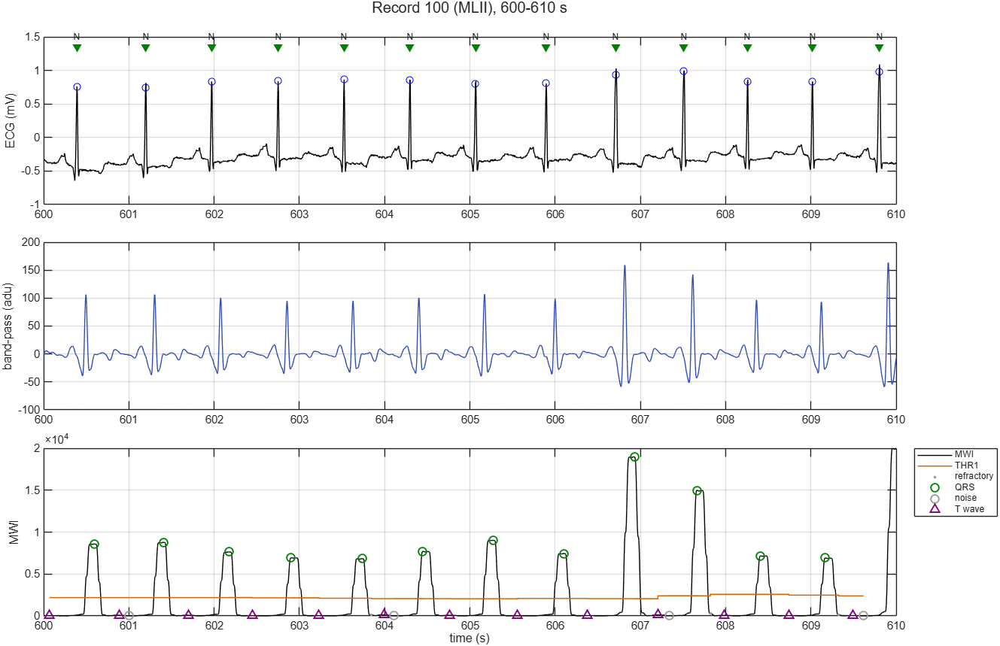
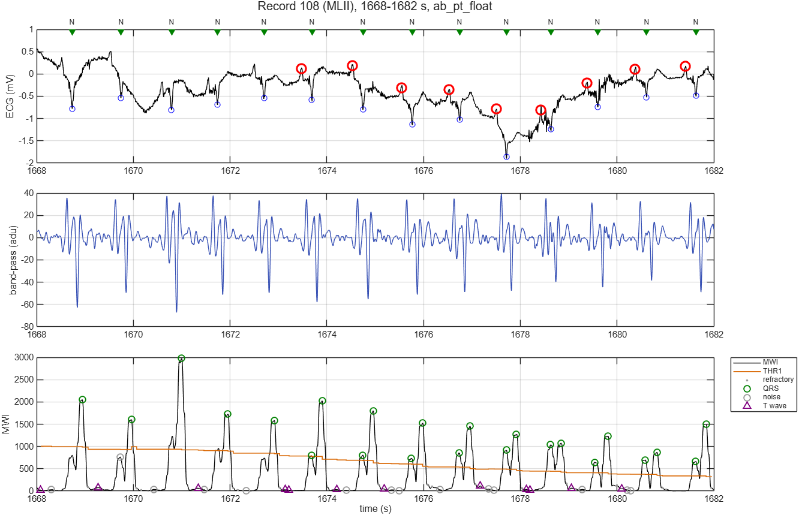

# ApproxBeat

**An ECG beat-detector ASIC that computes wrong on purpose.**

A wearable heart monitor has to run for months on a battery, yet finding heartbeats does
not need exact arithmetic. ApproxBeat measures how far the arithmetic of a Pan-Tompkins
QRS detector can be approximated (truncated multipliers, shortened carry chains, narrower
words) before beat detection on the MIT-BIH Arrhythmia Database degrades. The result is an
accuracy-area-power Pareto front built from real place-and-route runs, plus a Tiny
Tapeout chip.

## Status

| Stage | State |
|---|---|
| Data pipeline: WFDB readers, 200 Hz / 11-bit ADC model | done; verified against the WFDB checksums of all 48 records |
| Float reference model: streaming Pan-Tompkins | done; results below |
| Bit-accurate integer model | done; same Se / +P as the float model; results below |
| Robust searchback (record 228 tipping point) | done; chosen on DS1, confirmed on held-out DS2 |
| Golden vectors for the RTL: format, full set, committed smoke set | done ([docs/golden_vectors.md](docs/golden_vectors.md)) |
| RTL filter chain (Verilog) with cocotb regression | done; bit-exact on all 48 records, 17,342,976 samples ([results/rtl_filters.md](results/rtl_filters.md)) |
| RTL decision logic and core (`src/ab_core.v`) | done; end to end from ADC codes, all 48 records: 276,457 peak and 109,794 beat events bit-exact ([results/rtl_core.md](results/rtl_core.md)) |
| Generic Yosys synthesis | done; flip-flops reconciled with the register inventory ([results/synth_core.md](results/synth_core.md)) |
| Area step 1: one shared adder in the decision logic, no input latch | done; 1,489 flip-flops and 5,401 logic cells, down from 1,516 and 7,057 (D17) |
| Area step 2: classify the peak straight from the peak detector | done; 1,435 flip-flops and 5,441 logic cells (D18) |
| Further area work, Tiny Tapeout wrapper, LibreLane | next |
| LibreLane: IHP SG13G2 / GF180 | planned |
| Tiny Tapeout | target TTGF26c, closes 2026-12-07 |

Plan and dates: [docs/ROADMAP.md](docs/ROADMAP.md).

## Float baseline

All 48 records, full 30 minutes each, 150 ms match window. The numbers below come from
`ab_run_eval`; [results/float_baseline.md](results/float_baseline.md) lists every record.

| Set | Beats | Se (%) | +P (%) | DER (%) |
|---|---:|---:|---:|---:|
| all 48 records | 109,494 | 99.68 | 99.78 | 0.54 |
| 44 non-paced records | 100,733 | 99.67 | 99.76 | 0.57 |
| DS1, design set (22 records) | 51,021 | 99.58 | 99.70 | 0.72 |
| DS2, held-out set (22 records) | 49,712 | 99.76 | 99.82 | 0.41 |

Pan & Tompkins reported 99.3 % on this database (one minus the failed-detection rate). The
same figure here is 99.46 %. Of the 348 missed beats, 98 fall in the 1.92 s startup window.
Algorithm choices are made on DS1 and checked on DS2 (`docs/eval_protocol.md`, item 9).
The hardest record is 108: large P waves arrive about 200 ms before each QRS, just
outside the refractory period, and get counted as beats (second figure).





## Integer model

`ab_pt_int` is the bit-accurate golden model for the RTL. It runs the same state machine
as the float model, with every shift an arithmetic shift right, so the two can differ only
by rounding. Source: [results/int_study.md](results/int_study.md).

| Model | Se (%) | +P (%) | DER (%) | Flip-flops |
|---|---:|---:|---:|---:|
| float (`ab_pt_float`) | 99.68 | 99.78 | 0.540 | |
| integer (`ab_pt_int`), as built in `src/ab_core.v` | 99.68 | 99.78 | 0.544 | 1,463 |

What it took to get there, and what it showed:

- **Storage dominates the flip-flops, not the multiplier.** The four delay lines hold
  72 % of the 1,463 flip-flops ([results/state_inventory.md](results/state_inventory.md)).
  The squared derivative needs 22 bits in the worst case but only 16 bits on MIT-BIH.
  Generic synthesis first gave 7,057 logic cells, 4,434 of them in the decision logic,
  where each phase had its own adders. One shared adder, used once per cycle, cut the
  decision logic to 2,789 cells and the design to 5,401. Classifying each peak straight
  from the peak detector's registers then removed a 54-bit copy of it
  ([results/synth_core.md](results/synth_core.md), D16-D18).
- **A tipping point, found and removed.** At first, the integer model's accuracy depended
  on rounding details. Across six rounding variants the gross DER ranged from 0.572 % to
  0.747 %, and almost all of that came from one record. In 228 (bigeminy), large PVCs
  inflate the adaptive threshold until the small normal beats are lost for good, and its
  missed beats swung between 20 and 216 (D12). The fix clips each QRS peak to 1.25 x the signal level
  before it enters the running average, which costs a shift, an adder and a min. It was
  chosen on DS1 and improves the held-out DS2, where DER falls from 0.430 % to 0.412 %
  and record 228 from 20 to 3 missed beats. Record 228 now gives 3 under every rounding
  ([results/searchback_study.md](results/searchback_study.md), D14).
- **Short words need a held-out check.** Over all 48 records, the stored squared
  derivative looked fine in 8 bits instead of 16 (D13). Choosing by the protocol
  instead, the DS1 rule picked a 6-bit `sq` with 29 % fewer flip-flops. It looked better
  than the exact design on DS1 but failed on the held-out DS2: DER 0.668 % against
  0.422 %, mostly from false positives in record 222. The design keeps 16 bits
  ([results/wordlength_study.md](results/wordlength_study.md), D19).
- **Rounding details stopped mattering.** All six rounding variants now give DER
  0.513-0.547 %, including Pan & Tompkins' own truncate-then-square. Its 12-bit squarer
  is the first approximate-multiplier candidate (D9).

## Quick start

You need base MATLAB (no toolboxes) and, for the download script, Windows PowerShell
(on Linux, `wget -r -N -c -np https://physionet.org/files/mitdb/1.0.0/`).

```
powershell -NoProfile -ExecutionPolicy Bypass -File scripts\get_mitdb.ps1
matlab -batch "cd('matlab'); ab_test"
matlab -batch "cd('matlab'); ab_setup; ab_run_eval"
```

The first command downloads ~98 MB from PhysioNet and checks it. The second runs the unit
tests, and the third scores all 48 records and writes `results/float_baseline.{csv,md}`.
`ab_int_study` (about 10 minutes) regenerates every integer-model result. The RTL
testbenches run in WSL2. `scripts/setup_wsl.sh` sets up cocotb and Icarus Verilog and
self-tests them, and `scripts/wsl_make.ps1 tb\<bench>` runs a testbench from Windows. To
see what the detector does, run this inside MATLAB:

```
cd matlab; ab_setup
ab_plot_detection('108', [1668 1682])
```

## How it works

The detector is the Pan-Tompkins pipeline (band-pass, derivative, squaring, 150 ms moving
integration, adaptive thresholds with searchback), written as the per-sample state machine
the chip will run. It uses fixed-size state and only shifts, adds, compares and one squarer.
[docs/algorithm.md](docs/algorithm.md) is the specification, including a state inventory and
every deviation from the 1985 paper. [docs/eval_protocol.md](docs/eval_protocol.md) fixes how
accuracy is measured, and [docs/decisions.md](docs/decisions.md) records why each choice
was made.

```
matlab/
  io/      WFDB header, signal and annotation readers, resampler, record loader
  model/   ab_params (every constant), ab_pt_filters, ab_pt_decide, ab_pt_detect,
           ab_pt_float / ab_pt_int, ab_int_widths (word lengths), ab_state_inventory
  eval/    beat matching, scoring (ab_run_eval), studies, golden vectors, plots
  tests/   unit tests, run by ab_test
src/       Verilog: ab_filters.v (filter chain), ab_decide.v (decision logic), ab_core.v
tb/filters/, tb/decide/, tb/core/  cocotb testbenches, bit-exact against the golden vectors
tb/common/   event checker shared by the testbenches
flow/synth/  generic Yosys synthesis; report.py reconciles flip-flops with the inventory
tb/vectors/  golden-vector smoke set for the RTL testbench (committed)
tb/toolcheck/  end-to-end self-test of cocotb + Icarus
scripts/   get_mitdb.ps1 (download, SHA-256 check), setup_wsl.sh, wsl_make.ps1
docs/      algorithm spec, evaluation protocol, decision log, roadmap
results/   written by scripts, never edited by hand
data/      MIT-BIH, not committed
```

## Data and references

MIT-BIH Arrhythmia Database v1.0.0, PhysioNet, Open Data Commons Attribution License v1.0.

- J. Pan and W. J. Tompkins, "A real-time QRS detection algorithm," *IEEE Trans. Biomed.
  Eng.*, vol. BME-32, no. 3, pp. 230-236, 1985.
- G. B. Moody and R. G. Mark, "The impact of the MIT-BIH Arrhythmia Database," *IEEE Eng.
  Med. Biol. Mag.*, vol. 20, no. 3, pp. 45-50, 2001.
- A. L. Goldberger et al., "PhysioBank, PhysioToolkit, and PhysioNet," *Circulation*,
  vol. 101, no. 23, pp. e215-e220, 2000.
- ANSI/AAMI EC57, *Testing and reporting performance results of cardiac rhythm and ST
  segment measurement algorithms*.
